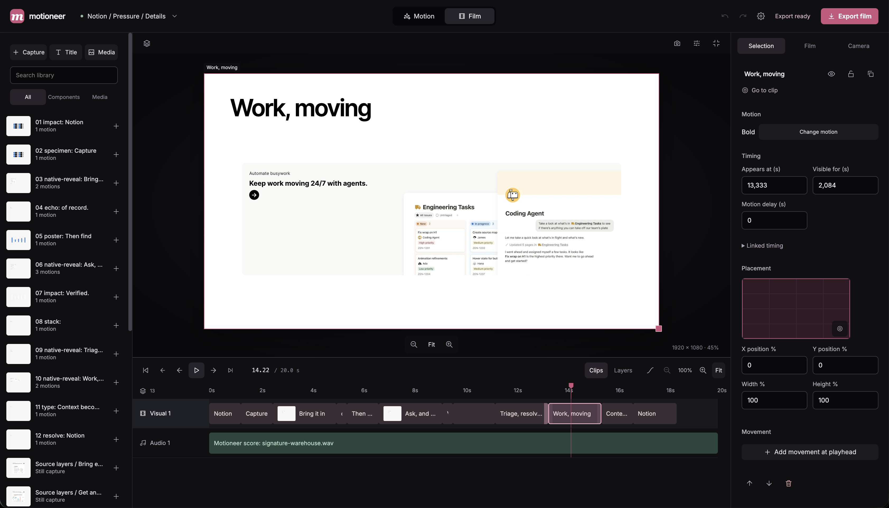

# Motioneer

**Prompt a product film. Refine it in your local studio.**

[](https://www.npmjs.com/package/motioneer)
[](https://modelcontextprotocol.io)
[](package.json)
[](LICENSE)

Motioneer gives your agent a motion studio. It captures real website elements, directs branded motion
in its Assembled house style, composes an original score, and returns two things: an MP4, and a
live HTML film made of your real interface. The HTML film keeps its text sharp at any size, fits
any frame, starts muted, and holds still for viewers who ask for less motion, so it can sit on your
own landing page. Native detail reveals use the site’s DOM/SVG, typography and colors; embedded
screenshots remain flattened.



## Start with your agent

### As a Claude Code plugin

In Claude Code, with Node 20 or newer:

```text
/plugin marketplace add AminKhorramii/Motioneer
/plugin install motioneer@motioneer
```

The plugin brings four things:
- the MCP server
- a skill that teaches the agent to direct films in the house style
- the slash commands `/motioneer:film`, `/motioneer:look`, `/motioneer:motion` and
  `/motioneer:change`, each pre-approved for the Motioneer tools it calls
- the renderer on demand: the first film installs it

### With setup

Use Node 20 or newer and Claude Code signed in on your machine. In your project directory:

```sh
npx -y motioneer setup --claude
```

Setup does three things:
- downloads Chromium and FFmpeg once into a shared local cache, and checks that the browser works
- adds Motioneer to the project’s `.mcp.json`, keeping other MCP entries and refusing to replace a
  different Motioneer configuration
- installs the directing skill

No API key is needed when using your signed-in Claude Code CLI. Use the plugin or setup, not both,
so the agent sees one set of Motioneer tools.

Restart Claude Code in this project and approve its Motioneer MCP server when prompted. Then ask:

> Make a 20-second snappy launch film from notion.so. Use real source elements, detail-to-interface
> reveals, the site’s fonts and colors, powerful warehouse techno, and a clean brand ending.
> Review the exported motion and return the video and editor links.

The agent starts the studio, captures, directs, scores and renders. The first film also installs the
renderer automatically if needed. The result includes a local MP4, a transition storyboard, a source
sheet and an editor link. Projects and earlier takes stay local; the model receives the prompt and
source material needed to direct the film through your configured provider.

Focused follow-ups can refine selected motion tracks into a new take while preserving the source
film and audio. The agent can review sampled exported frames and report unresolved issues.
See [review, refinement and recorded sound kits](docs/agentic-films.md).

See [example prompts](docs/native-examples.md) and the [prompt-to-film workflow](docs/chat-to-film.md).

## Claude Desktop

On macOS or Windows with Node 20+, connect Desktop with one command:

```sh
npx -y motioneer setup --claude-desktop
```

Fully quit and reopen Claude Desktop, then ask for a film. Setup prepares the renderer,
creates a persistent `~/Motioneer` workspace, and safely adds the MCP connection with a
backup of any existing config. Other servers stay intact. Use `--dir` for another folder.
A signed-in Claude Code/Codex CLI or a provider configured in Motioneer's Settings is
still required for generation. See [Desktop setup](docs/setup.md#claude-desktop).

## Codex and ChatGPT

With the current Codex CLI installed and signed in, run this in your project:

```sh
npx -y motioneer setup --codex
```

Open the trusted project in Codex, restart the client, and check `/mcp`. Use the same film prompt
above. Setup creates `.codex/config.toml` with the workspace and a 20-minute film-tool timeout.
If that file already has your own settings, setup preserves it and prints instructions for merging
`npx -y motioneer mcp-config --codex`. Global Codex configuration stays untouched.

The Codex connection selects your signed-in Codex CLI to generate motions. Existing saved studio
provider settings take precedence; choose **Codex, on this machine** in Settings to change them.
No API key is needed for this CLI path. It uses Codex's default model unless you choose one.

ChatGPT desktop clients using the same local Codex host can share this MCP configuration.
ChatGPT web requires a remote MCP app; Motioneer's local stdio server does not connect directly
to the web client. A hosted ChatGPT connector is not included. See [setup details](docs/setup.md#codex-and-chatgpt).

## Other MCP clients

Print the configuration for the current workspace and add its `motioneer` entry to your client:

```sh
npx -y motioneer mcp-config
```

The entry pins the installed package version and workspace. The server also runs directly with
`npx -y motioneer mcp`; the existing `motioneer-mcp` binary remains available. See the
[setup guide](docs/setup.md) for headless environments and separate studio ports.

## Check your setup

```sh
npx -y motioneer doctor
npx -y motioneer doctor --json
```

Doctor checks packaged files, workspace access, model configuration and an actual browser launch.
It makes no model request or downloads. Authentication is checked on the first model request.
JSON output contains no credentials and exits with status 1 when setup is incomplete.

Motioneer detects Claude Code, then Codex, then `ANTHROPIC_API_KEY` or `OPENAI_API_KEY`.
The Codex setup explicitly selects Codex; saved studio Settings take precedence. You can choose
another provider there. Keys are never written into the generated MCP entry.

## Open the studio yourself

```sh
npx -y motioneer
npx -y motioneer localhost:3000
npx -y motioneer ~/app/src/ui --css ~/app/globals.css
```

The studio opens on included examples or your running app. Capture components, compare motions,
edit films and export from the browser. Use `--no-open` for a headless process or `--dir` to choose
where `.studio` projects and settings are stored.

## What it does

**Pick anything on the page.** Reading a component out of a `.tsx` is guesswork, so it does not:
your app is proxied through the studio's own origin, which makes the frame same origin, which makes
its dom readable. A picked element brings the rules that actually matched it, plus a snapshot of
every computed value, so it looks like itself once it is lifted out.

**Several motions, one clock.** Each option is dealt a different verb and a different errand from
two decks, so they disagree by construction rather than being five takes on a fade. One scrubber
holds all of them at the same instant. Open one to fill the screen, ask for more like the one that
nearly worked, or adjust its speed and spacing without asking again.

**Pick several elements** and they become a rail: one motion each, played on one timeline, with
each start draggable and each subject able to carry its own camera.

**Judged before you see it.** Ten gates read the sheet and an eleventh renders it: a motion that
leaves the component twelve pixels down forever, or invisible, or animating nothing at all, passes
every reading of the text and fails on sight. Options are ordered by what the rendering measured,
so the ones you can actually see come first.

**Keep what you like.** Saved motions live in your browser, so a restart does not lose them, and
each comes away as one file that opens anywhere. **Film** renders what is on screen frame by frame
and encodes it in the page itself, so posting a clip needs nothing installed.
The [Film editing guide](docs/film-editing.md) covers cuts, layers, movement, and keyboard controls.

## The stylesheet

What comes out is a `.motion.css` scoped to one data attribute you add to the root element. No
runtime, no dependency, no framework. Keyframe names are rewritten so a sheet defining `rise`
cannot replace whatever your application already called `rise`, and everything is wrapped in
`prefers-reduced-motion`.

## For an agent

Eight tools, one job each:
- **`film`:** a video of a site, a demo of named elements, or an idea in words.
- **`change`:** every reaction afterwards, as a new take: the cut, the motion, the timing (exactly,
  with no model call) or the music.
- **`look`:** what is on a page before filming, or a film's frames afterwards. A shot can be shown
  as six frames, which is how an arrival is judged.
- **`motion`:** CSS for markup you already have.
- **`projects`:** finds earlier work.
- **`studio`**, **`open`** and **`doctor`:** the rest.

Every reply carries a `summary` and the `next` calls that make sense, inside the structured copy
clients show the model. `setup --claude` also installs a skill with the long guidance.

Everything Motioneer makes follows one house style, Assembled: nothing fades in, and the real
interface is built part by part, each part timed like a real object. Each film reports how far it
is from that style. See [the house style](docs/assembled.md).

## Developing on it

```
npm run studio        watches its own sources: save a file and it is back in half a second
                      with your aim, your picks and your options put back
npm run verify:all    the suites that need no network
npm run verify:studio twenty real sites through the proxy
```

`docs/architecture.md` is the module map and `docs/flows.md` is every path through the studio and the
code that carries it.
